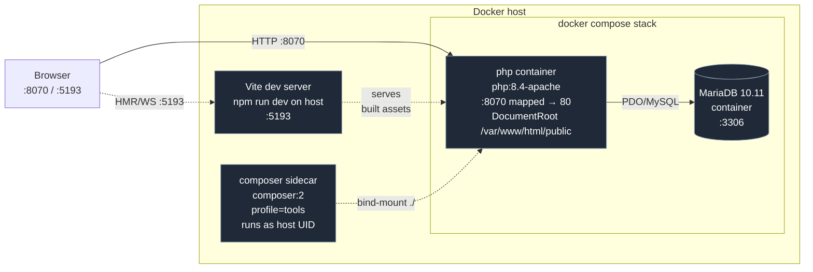

# KTN Gestión

> Administration system for **Ketten**, an event production company —
> built on `symfony-backoffice-skeleton` (RBAC, auth, i18n, CRUD scaffolding,
> notifications, and cPanel deploy tooling).

[](https://www.php.net)
[](https://symfony.com)
[](https://mariadb.org)
[](https://vitejs.dev)
[](https://tailwindcss.com)
[](https://httpd.apache.org)

This repository is a **downstream** of `symfony-backoffice-skeleton`. It is
backoffice-only: the root URL redirects to `/login`. Shared infrastructure is
pulled from the skeleton (git remote `skeleton`) through the tag-bounded
cherry-pick workflow in `BRANCHING.md`; Ketten's business modules live only
here.

| Service | URL / port |
|---|---|
| App | <http://localhost:8070> |
| Mailpit UI / SMTP | <http://localhost:8075> / `1075` |
| Vite dev server | <http://localhost:5193> |
| MariaDB (host) | `127.0.0.1:33096` |
| Test user | `test@ketten.local` / `test` |

The sections below are inherited from the skeleton and apply unchanged unless
they mention otherwise.

---

## Table of contents

1. [Overview](#1-overview)
2. [Architecture](#2-architecture)
3. [Quick start](#3-quick-start)
4. [Project structure](#4-project-structure)
5. [Daily development workflow](#5-daily-development-workflow)
6. [Frontend pipeline](#6-frontend-pipeline)
7. [Database workflow](#7-database-workflow)
8. [Design system](#8-design-system)
9. [Infrastructure reference](#9-infrastructure-reference)
10. [Common tasks](#10-common-tasks)
11. [Authentication and backoffice](#11-authentication-and-backoffice)
12. [RBAC and the permission catalog](#12-rbac-and-the-permission-catalog)
13. [The shared Twig CRUD base](#13-the-shared-twig-crud-base)
14. [Troubleshooting](#14-troubleshooting)
15. [Command cheat sheet](#15-command-cheat-sheet)
16. [Forking the skeleton](#16-forking-the-skeleton)
17. [License](#17-license)

---

## 1. Overview

### Notifications

The reusable notification inbox is at `/account/notifications`. The bell in
the backoffice shows recent items and the unread count. Device settings are at
`/account/profile-settings/notifications`. Chrome desktop and Android Web Push
are optional: each device opts in separately. See `README_DEPLOY.md` §
"Notifications and cron" for cPanel setup.

Development walkthrough:

```bash
docker compose exec php bin/console doctrine:migrations:migrate --no-interaction
docker compose exec php bin/console app:notifications:vapid-keys
# Store the printed keys in .env.local, set NOTIFICATION_PUSH_ENABLED=1,
# and set NOTIFICATION_VAPID_SUBJECT to a valid contact mailto: address.
# Sign in and enable this device under Account → Notifications.
docker compose exec php bin/console app:dev:test-notification test@ketten.local
docker compose exec php bin/console app:notifications:process -v
# Emoji/click-through demonstration (recipient needs permission to manage users):
docker compose exec php bin/console app:dev:test-notification test@ketten.local --users
docker compose exec php bin/console app:dev:test-notification test@ketten.local --variant=warning
docker compose exec php bin/console app:dev:test-notification test@ketten.local --variant=security
docker compose exec php bin/console app:dev:test-notification test@ketten.local --variant=download
docker compose exec php bin/console app:notifications:process -v
docker compose exec php php tests/notification_smoke.php
node tests/notification_worker_click.cjs
```

Desktop Chrome works on `http://localhost:8070`. Android must access a trusted
HTTPS origin, not `http://<LAN-IP>:8070`; permission must be granted on the phone.
No background daemon is started automatically in development: manually run the
processor to simulate a cron tick. The inbox works with push disabled.

The notification icon and browser favicon use `public/skeleton-logo.png` (512px).
Its editable source is `assets/branding/skeleton-logo.svg`; regenerate the PNG
with `bash scripts/build-skeleton-logo.sh` (requires ImageMagick).

Business services call `App\Service\Notification\CreateNotification::execute()`
with the recipient, translation keys, destination route, and optionally a stable
deduplication key and a permission from `App\Security\Permission`. One record is
created per recipient. The publisher flushes the current unit of work and joins
an outer DBAL transaction if present; wrap the business change and publication
in the same transaction. Do not call it from Doctrine lifecycle callbacks.
Recipients and business-specific translations remain the downstream's concern.

`NotificationDelivery` itself is the queue: concrete services process due rows,
retry transient failures up to five attempts, and record per-device outcomes.
No Messenger, gateway interfaces, custom value objects, or definition registry
are involved. Only Web Push is implemented; an email sender can be added as a
new concrete service when required. Read actions require ownership and CSRF;
GET links never mutate read state. Native notification clicks request a new tab,
preserving existing backoffice tabs and unsaved forms. Push-service acceptance is not proof of display.
The inbox has Inbox / Unread / Archived filters. Unread rows offer Mark as read;
read, non-archived rows offer Archive; archived rows offer Restore to inbox.
Only read notifications can be archived (also enforced server-side). Archiving
removes the item from the bell/feed and cancels pending push deliveries. Restore
preserves the original read timestamp and never queues or revives a delivery.
Notifications already accepted cannot be recalled and interrupted sends may be
repeated. Browser notification tags reduce duplicate display.

The Symfony Backoffice Skeleton is a working Symfony application that ships
only the backoffice: auth, RBAC, account lifecycle, profile settings, i18n, and
the shared CRUD base. It is the common ancestor of two downstream projects.

**Stack:**

- **Backend:** Symfony 7.4 LTS on PHP 8.4, Doctrine ORM 3.6, Twig 3
- **Auth & forms:** Symfony Security 7.4 (form login + stateless CSRF +
  login throttling), Symfony Form 7.4, Symfony Validator 7.4
- **Web server:** Apache 2.4 (in a single `php:8.4-apache` container —
  no separate `php-fpm` + `nginx` orchestration to keep ops simple)
- **Database:** MariaDB 10.11 in Docker (parity with cPanel shared hosting
  used by the downstream projects)
- **Frontend:** Vite 5 with `vite-plugin-symfony`, Tailwind 3.4 for styling
- **Dev tooling:** `symfony/maker-bundle` for scaffolding, Doctrine
  Migrations for schema changes, Doctrine Fixtures for seed data, Web
  Profiler for debug introspection in dev
- **Deploy tooling:** `bin/deploy.php` + `scripts/build-cpanel-zip.sh` for
  FTP-only cPanel hosts (shared between the downstream projects)

**Surfaces:**

- **Public** — there is none. `GET /` redirects to `/login`.
- **Backoffice** — the authenticated admin area at `/dashboard` (gated by
  RBAC: `User → Role → Permission`).

**Why this stack:** the downstream projects need a maintainable Symfony app
with a working backoffice. Vite + Tailwind give HMR in dev and a tight
production build without hand-rolling a CSS pipeline, while keeping the server
side boring and reusable.

---

## 2. Architecture



**Request flow at a glance:**

- **Static asset request in dev** — Vite dev server (host :5193) is reached
  directly by the browser via HMR; the Symfony app's rendered HTML still
  points to local Vite URLs via `vite_entry_*_tags()`.
- **Static asset request in production** — `vite build` writes
  fingerprinted assets into `public/build/`, Apache serves them directly.
- **App request** — always hits Apache (:8070 → container :80), which routes
  through `public/index.php` (front controller).

---

## 3. Quick start

### Prerequisites

| Tool | Version | Notes |
|---|---|---|
| Docker | 29+ | Docker Desktop or `docker-ce` |
| Docker Compose | v2 (bundled) | `docker compose` (not `docker-compose`) |
| Node.js | 18.19+ | Vite 5 is the last Vite line that supports Node 18; Vite 8+ requires Node 20.19+ |
| npm | 9+ | Bundled with Node 18 |
| Git | any | |

**Nothing else.** No host PHP, no host Composer — everything runs in
containers.

### First-time setup

```bash
git clone git@github.com:ortiz-facundo/ktn_gestion.git
cd ktn_gestion
git remote add skeleton git@github.com:ortiz-facundo/symfony-backoffice-skeleton.git
git fetch skeleton --tags
docker compose up -d --build    # builds the php image, starts php + db
```

The first build takes ~3 minutes (it installs system libs, builds PHP
extensions, pulls MariaDB). Subsequent starts are under 10 seconds.

### One-time local Node setup (only if you want to rebuild assets)

```bash
npm install
```

This populates `node_modules/` for Vite, Tailwind, and PostCSS. The Symfony
container doesn't need this — it just serves the already-built `public/build/`
files.

### Verify it works

```bash
# 1. Root URL redirects to /login
curl -sI http://localhost:8070/ | head -2
# → HTTP/1.1 302 Found
# → Location: http://localhost:8070/login

# 2. Login page renders
curl -sI http://localhost:8070/login | head -1
# → HTTP/1.1 200 OK

# 3. Unauthenticated /dashboard redirects to /login
curl -sI http://localhost:8070/dashboard | head -2
# → HTTP/1.1 302 Found
# → Location: http://localhost:8070/login

# 4. MariaDB is reachable from the php container
docker compose exec php php bin/console doctrine:database:create --if-not-exists
# → Database "app" for connection named default already exists. Skipped.
```

Open <http://localhost:8070> — the browser will land on the login page. This
is the smoke test that confirms Apache routing, Twig rendering, Vite asset
emission, and Tailwind compilation are all working together.

### Verifying the backoffice

After booting the stack, run the migrations and load the fixtures:

```bash
docker compose exec php bin/console doctrine:migrations:migrate --no-interaction
docker compose exec php bin/console doctrine:fixtures:load --append
```

Log in with the test user:

| Field | Value |
|---|---|
| Email | `test@ketten.local` |
| Password | `test` |
| Role | `ROLE_ADMIN` (all five permissions) |

The fixtures are idempotent (use `doctrine:fixtures:load --append` to keep
existing rows).

### Language / locale

The entire UI is bilingual (English + Spanish). Spanish is the default for
unauthenticated traffic (`/login`, `/account/confirm`); signed-in users can
pick a language under **Perfil y Ajustes → Idioma** (English: **Profile &
Settings → Language**). The preference is stored on the `User` row, not in a
cookie. See `AGENTS.md` §"Internationalization" for the full convention.

---

## 4. Project structure

```
.
├── apache/
│   └── skeleton.conf            # Apache vhost: DocumentRoot → public/, AllowOverride All
├── assets/                       # Vite inputs (the only frontend source code)
│   ├── app.js                    # JS entry — imports styles/app.css
│   └── styles/
│       └── app.css               # CSS entry — @tailwind base/components/utilities
├── bin/
│   └── console                   # Symfony console entry point
├── compose.override.yaml         # Dev-only override (DB port + Mailpit)
├── composer.json / .lock         # PHP deps (canonical source for backend versions)
├── config/
│   ├── bundles.php               # Bundle registry
│   ├── packages/                 # Per-bundle configs (twig.yaml, doctrine.yaml, vite.yaml, …)
│   ├── routes/                   # Routing imports (controllers auto-discovered)
│   └── services.yaml             # Service container config
├── docker/
│   └── php/
│       ├── opcache.ini           # Recommended opcache settings for dev
│       └── apcu.ini              # APCu config (128 MB)
├── docker-compose.yml            # php / database / composer services
├── Dockerfile                    # php:8.4-apache + intl/opcache/pdo_mysql/zip + vhost
├── migrations/                   # Doctrine migration files (committed)
├── public/                       # Web root
│   ├── index.php                 # Symfony front controller
│   ├── .htaccess                 # From symfony/apache-pack (URL rewriting, security headers)
│   └── build/                    # Generated by vite build (gitignored)
├── src/
│   ├── Command/Dev/              # Shared dev tools (TestEmailCommand)
│   ├── Controller/
│   │   ├── AbstractCrudController.php  # Shared horizontal — CRUD base
│   │   ├── HomeController.php          # Shared — redirect to /login (overridable by downstream)
│   │   ├── Account/                    # Account module — self-service
│   │   │   ├── ProfileSettingsController.php
│   │   │   └── SecuritySettingsController.php
│   │   ├── Administration/             # Administration module — RBAC CRUD + impersonation
│   │   │   ├── ImpersonateController.php
│   │   │   ├── PermissionController.php
│   │   │   ├── RoleController.php
│   │   │   └── UserController.php
│   │   ├── Backoffice/                 # Backoffice module — chrome
│   │   │   └── DashboardController.php
│   │   └── Security/                   # Security module — auth flow
│   │       ├── AccountConfirmationController.php
│   │       ├── LoginController.php
│   │       └── LogoutController.php
│   ├── DataFixtures/
│   │   ├── AppFixtures.php       # Shared — orchestrator
│   │   ├── Administration/       # PermissionFixtures, RoleFixtures, UserFixtures
│   ├── Entity/
│   │   ├── Administration/       # Permission, Role, User
│   │   └── Security/             # AccountConfirmationToken
│   ├── Form/
│   │   ├── Account/              # ChangePasswordFormType
│   │   ├── Administration/       # RoleType, UserType
│   │   └── Security/             # AccountPasswordFormType
│   ├── Mailer/
│   │   └── Security/             # AccountMailer
│   ├── Repository/
│   │   ├── Administration/       # PermissionRepository, RoleRepository, UserRepository
│   │   └── Security/             # AccountConfirmationTokenRepository
│   ├── Security/                 # Top-level — cross-cutting
│   │   ├── Permission.php        # Central catalog (PERMISSION_*, all(), isValid())
│   │   └── PermissionVoter.php   # Universal voter (matches PERMISSION_*)
│   ├── Service/
│   │   ├── Account/              # VerifyCurrentPassword
│   │   └── Security/
│   │       ├── UserStateChecker.php
│   │       └── UserLifecycle/    # State machine + token services
│   └── Twig/
│       ├── UserAvatarExtension.php
│       └── Administration/
│           └── ImpersonationExtension.php
└── templates/
    ├── base.html.twig            # Shared — backoffice layout (no public chrome)
    ├── _avatar.html.twig         # Shared
    ├── _state_pill.html.twig     # Shared
    ├── form/theme.html.twig      # Shared — Tailwind form theme
    ├── shared/crud/              # Shared — CRUD partials
    ├── backoffice/               # Backoffice module — chrome
    ├── account/                  # Account module — self-service
    ├── administration/           # Administration module — CRUD
    └── security/                 # Security module — auth flow + email templates
```

The project is organised by **module**, not by entity type. Each module owns
its own `Controller/`, `Entity/`, `Form/`, `Repository/`, etc. **under a
single top-level namespace per type** — `App\Controller\Administration\…`,
`App\Entity\Administration\…`, etc. Shared/horizontal concerns live at the
type root (`App\Controller\AbstractCrudController`, `App\Twig\UserAvatarExtension`,
etc.).

When new business-domain entities (e.g. catalog, inventory, production,
sales, listings) arrive in a downstream project, each gets its own module —
not a "Business" bucket. The module name should match the domain concept.

---

## 5. Daily development workflow

```bash
# Start the stack (rebuilds the php image if Dockerfile changed)
docker compose up -d --build

# Stop (keeps the MariaDB data volume)
docker compose down

# Reset everything including the database
docker compose down -v && docker compose up -d --build

# Symfony console
docker compose exec php bin/console <cmd>

# Composer (always via the sidecar)
docker compose --profile tools run --rm composer <cmd>

# HMR on the host (one terminal, leave running)
npm run dev

# Production build of frontend assets (writes to public/build/)
npm run build
```

URLs once running:

- App (root): redirects to <http://localhost:8070/login>
- Login: <http://localhost:8070/login>
- Dashboard: <http://localhost:8070/dashboard> (auth required)
- Admin (CRUD): <http://localhost:8070/admin/users>, `/admin/roles`,
  `/admin/permissions`
- Profile: <http://localhost:8070/account/profile-settings>
- Mailpit (dev): <http://localhost:8075>
- Vite: <http://localhost:5193> (only when `npm run dev` is running)
- DB: `127.0.0.1:33096` from host (loopback only; via `compose.override.yaml`),
  `database:3306` from inside containers

---

## 6. Frontend pipeline

The host runs `npm run dev` (Vite) for HMR; the Symfony container only
serves the already-built `public/build/` files. Run `npm run build` after
adding new Tailwind classes to a template — the JIT only emits classes that
appear in the `content` globs.

`assets/app.js` is the only entry point registered. Adding a new entry (e.g.
`admin`) means editing `vite.config.js` `build.rollupOptions.input` and
adding `{{ vite_entry_link_tags('admin') }}` / `{{ vite_entry_script_tags('admin') }}`
to the relevant template.

See `AGENTS.md` §"Color palette" and §"Typography" for the design tokens
that ship with the skeleton.

---

## 7. Database workflow

```bash
# New entity
docker compose exec php bin/console make:entity

# Generate a migration (review the generated file before committing)
docker compose exec php bin/console make:migration

# Apply pending migrations
docker compose exec php bin/console doctrine:migrations:migrate --no-interaction

# Load fixtures (dev only — wipes data first unless --append)
docker compose exec php bin/console doctrine:fixtures:load --append

# Drop + recreate the database (dev only)
docker compose exec php bin/console doctrine:database:drop --force
docker compose exec php bin/console doctrine:database:create

# Inspect the database directly (MariaDB)
docker compose exec php bin/console dbal:run-sql "SELECT id, name FROM role"
```

Entity mapping is by PHP 8 attribute (not XML/YAML). MariaDB uses
`AUTO_INCREMENT` for identity columns by default — no special Doctrine
configuration is required.

---

## 8. Design system

The skeleton ships a deliberately neutral backoffice design:

- **Palette:** stone (neutral grays) for chrome, amber-600/700 as the single
  accent. No purple, no blue, no gradients. Replace with the brand palette
  when it's chosen.
- **Typography:** `font-serif` (Georgia) for page titles, default sans-serif
  for everything else. Replace when the brand picks a font pair.
- **Buttons:** `bg-stone-900` for primary, `text-rose-700` for destructive,
  `text-amber-700` for in-row edit links. All in `rounded-md`.
- **User chip:** the sidebar footer shows an initials-avatar (deterministic
  colour from `crc32(email) % palette`, see `UserAvatarExtension`) wrapping
  a name+email link to `/account/profile`. Sign-out is a separate small
  button below the chip.

The public homepage is intentionally absent. Downstream projects that want a
marketing site should override `App\Controller\HomeController` and add a
`templates/home/` directory; the skeleton's redirect is the baseline.

**Anti-patterns to avoid** (from `.opencode/skills/frontend-design/SKILL.md`):

- Generic sans-serifs (Inter, Roboto, Arial, system-ui defaults).
- Purple-on-white gradient clichés.
- Cookie-cutter, predictable component shapes and layouts.

---

## 9. Infrastructure reference

See `INFRASTRUCTURE_PLAN.md` for the full rationale behind the infrastructure
choices (why Vite 5 and not 6, why PHP 8.4 and not 8.3, why no named volumes
for `vendor/var`, why MariaDB instead of PostgreSQL, why a single
`php:8.4-apache` container instead of `php-fpm` + `nginx`).

`docker-compose.yml` defines three services: `php` (Apache), `database`
(MariaDB 10.11), and `composer` (sidecar, `profile=tools`, never
auto-starts). `compose.override.yaml` adds the dev DB port mapping and
Mailpit.

---

## 10. Common tasks

For step-by-step recipes for the most common backend/frontend tasks, see
`AGENTS.md` §"When the user asks you to 'add a feature,' default checklist".

---

## 11. Authentication and backoffice

### Authentication

- **Form login only** at `/login`. Username is email (`_email` form field);
  password is `_password`. CSRF via the framework's stateless mechanism.
- **Logout** at `/logout` is POST-only with CSRF (`csrf_token_id: logout`).
  The firewall intercepts — the `LogoutController` action should never
  execute; if it does, it throws because something is misconfigured.
- **Login throttling**: 5 attempts per 15 minutes per IP, via
  `symfony/rate-limiter`. Configured in `config/packages/security.yaml`.

### RBAC: User → Role → Permission

```
       PERMISSION_*  (string constants in App\Security\Permission)
            │
            │  many-to-many
            ▼
          ROLE_*    (Role entity; e.g. ROLE_ADMIN, ROLE_USER)
            │
            │  many-to-many
            ▼
          USER      (app_user table)
```

- **Permission catalog** is hardcoded in `App\Security\Permission` as
  `public const string PERMISSION_*`. The current 5 are:
  - `PERMISSION_VIEW_BACKOFFICE`
  - `PERMISSION_MANAGE_USERS`
  - `PERMISSION_MANAGE_ROLES`
  - `PERMISSION_MANAGE_PERMISSIONS`
  - `PERMISSION_IMPERSONATE_USERS`
- **Roles** are rows in the `role` table. Baseline fixtures seed exactly two:
  `ROLE_ADMIN` (all catalog permissions) and `ROLE_USER` (view only).
- **Users** carry roles via the `user_role` join table. New users get
  `ROLE_USER` by default; admins reassign via `/admin/users/{id}/edit`.
- **The permission seed migration** runs `Permission::all()` and inserts one
  row per constant. The migration is idempotent (`ON CONFLICT DO NOTHING`).
- **RoleFixtures is also idempotent for new permissions**: when a new
  permission is added to `Permission::all()`, re-running `RoleFixtures`
  (via `doctrine:fixtures:load --append`) attaches it to `ROLE_ADMIN` if
  it isn't already.

### Impersonation ("log in as")

Admins with `PERMISSION_IMPERSONATE_USERS` see a "users" icon on every User
row in `/admin/users`. Clicking it POSTs to `ImpersonateController::impersonate`,
which validates a per-row CSRF token, rejects self-impersonation and
admin-to-admin impersonation, logs to `audit`, and redirects to
`/dashboard?_switch_user=<email>`. Symfony's `SwitchUserListener` catches
it.

`templates/backoffice/base.html.twig` renders an **amber banner** while a
`SwitchUserToken` is active, with an "Exit impersonation" button that POSTs
to `exitImpersonation` (CSRF + audit log).

### User lifecycle (state machine)

Accounts have three states: `USER_STATE_PENDING`, `USER_STATE_ACTIVE`,
`USER_STATE_DISABLED`. State transitions go through
`App\Service\Security\UserLifecycle\*` services, never directly on the
entity. Confirmation flow: admin creates a user → email goes out with a
token link → user clicks → `AccountConfirmationController` → password set →
state → Active.

See `AGENTS.md` §"User lifecycle" for the full state machine.

### Internationalization

The entire UI is bilingual (English + Spanish). Spanish is the default for
unauthenticated traffic. English is the source-of-truth locale for
translations. The catalog is organised per-module
(`translations/<module>/messages.<locale>.yaml`). The user's preferred
language is stored on `User.locale`; `LocaleResolver` reads it and falls
back to Spanish when null.

Adding a new string: add the key to `translations/<module>/messages.en.yaml`
first, mirror it in `messages.es.yaml`, then `{{ 'app.<module>.<key>'|trans }}`.

---

## 12. RBAC and the permission catalog

The permission catalog is the single source of truth. Adding a new
permission:

1. Append a constant + add to `App\Security\Permission::all()`.
2. Generate a new migration that calls `Permission::all()` and INSERTs the
   new constant name with `ON CONFLICT DO NOTHING`.
3. Run migrations.
4. Run `doctrine:fixtures:load --append` to attach the new permission to
   `ROLE_ADMIN` automatically.
5. Add a `permission.<NAME>.label` and `permission.<NAME>.description` key
   to `translations/security/messages.<locale>.yaml` (both locales).
6. Optionally assign the permission to other roles via the backoffice.

The `User` entity uses `App\Security\Permission`'s `::all()` to seed the
catalog. The `User::getRoles()` method flattens the user's roles into a
single string array ([`ROLE_USER`, `role names`, `permission names from
each role`]). The `PermissionVoter` exists as a defence in depth — it
matches `PERMISSION_*` attributes against `User::getRoles()`.

---

## 13. The shared Twig CRUD base

Every entity that needs full CRUD (list, new, edit, delete) reuses these
moving parts:

- **`src/Controller/AbstractCrudController.php`** — reusable controller
  implementing `list`, `new`, `edit`, `delete`, plus a `view` route. A
  concrete controller extends it and supplies a small contract:
  `getEntityClass()`, `getFormType()`, `getTemplatePrefix()`,
  `getRoutePrefix()`, `getListColumns()`, `getRequiredPermission()`,
  `getEntityLabel()`, `getEntityDisplayName()`, `findEntity()`,
  `newEntity()`.
- **`templates/shared/crud/_*.twig`** — reusable partials (`_list`,
  `_form`, `_delete_form`, `_empty_state`, `_breadcrumbs`, `_row_actions`).
  Each takes a documented contract of variables.

To add a new entity with full CRUD (in a downstream project), you only need
four thin templates:

- `templates/<entity>/list.html.twig` — wraps `_list.html.twig`
- `templates/<entity>/new.html.twig` — wraps `_form.html.twig`
- `templates/<entity>/edit.html.twig` — wraps `_form.html.twig`
- `templates/<entity>/view.html.twig` — read-only details page

---

## 14. Troubleshooting

| Symptom | Fix |
|---|---|
| `composer` complains about a class that exists in `vendor/` | The Flex recipe may have desynced. See `INFRASTRUCTURE_PLAN.md` §"Step 2 deviations". |
| `dev/docker-compose.yml` complains about "no extension able to load the configuration for 'vite'" | The vite-bundle config key is `pentatrion_vite:`, not `vite:`. |
| Tailwind classes are missing from the rendered HTML | `npm run build` (or leave `npm run dev` running for HMR). |
| Postgres connection error | Confirm you are not editing the Mongo/Postgres version; this skeleton uses MariaDB. |
| `MAILER_FROM` etc. are placeholders | Compose runs `MAILER_DSN=smtp://mailer:1025` (Mailpit) in dev. In prod, override `MAILER_FROM`, `MAILER_FROM_NAME`, `MAILER_DSN`, `APP_URL` in `.env.local`. |

---

## 15. Command cheat sheet

```bash
# Containers
docker compose up -d --build
docker compose down
docker compose down -v && docker compose up -d --build
docker compose exec php bin/console <cmd>
docker compose exec php <cmd>          # any php binary
docker compose --profile tools run --rm composer <cmd>

# Frontend
npm install
npm run dev                            # HMR
npm run build                          # production build

# Database
docker compose exec php bin/console doctrine:migrations:migrate --no-interaction
docker compose exec php bin/console doctrine:fixtures:load --append
docker compose exec php bin/console doctrine:database:drop --force
docker compose exec php bin/console doctrine:database:create
docker compose exec php bin/console dbal:run-sql "SELECT id, name FROM role"

# Caching
docker compose exec php bin/console cache:clear
docker compose exec php bin/console cache:warmup

# Linting
docker compose exec php bin/console lint:twig templates/
docker compose exec php bin/console lint:yaml translations/
docker compose exec php bin/console lint:translations --locale=en
docker compose exec php bin/console lint:translations --locale=es
```

---

## 16. Forking the skeleton

You have two paths to start a new downstream project from this skeleton:

### Option A — `git clone` (recommended for new projects)

```bash
git clone git@github.com:ortiz-facundo/symfony-backoffice-skeleton.git my-new-project
cd my-new-project
git remote rename origin skeleton
git remote add origin git@github.com:ortiz-facundo/my-new-project.git
git push -u origin main
```

This is a clean copy. You can periodically pull improvements from the
skeleton via the tag-bounded cherry-pick workflow documented in
`BRANCHING.md` (`git fetch skeleton` → `git log skeleton-sync..skeleton/main`
→ `git cherry-pick <sha>` per commit → advance the `skeleton-sync` tag).

### Option B — `git remote add` (recommended for existing projects)

```bash
cd my-existing-project
git remote add skeleton git@github.com:ortiz-facundo/symfony-backoffice-skeleton.git
git fetch skeleton
```

See `BRANCHING.md` for the full tag-bounded cherry-pick workflow.

### Customising the skeleton

After cloning, replace the following placeholders:

| Placeholder | Where | Replace with |
|---|---|---|
| `Skeleton` (display name) | `templates/base.html.twig`, `templates/backoffice/_sidebar.html.twig`, `templates/security/login.html.twig`, `templates/backoffice/base.html.twig`, `templates/account/base.html.twig` | Your product name |
| `test@skeleton.local` | `src/DataFixtures/Administration/UserFixtures.php` | Your test user email |
| `no-reply@skeleton.local` | `.env`, `.env.dev`, `src/Command/Dev/TestEmailCommand.php` | Your no-reply address |
| `MAILER_FROM_NAME` | `.env`, `.env.dev` | Your product name |
| `apache/skeleton.conf` | `Dockerfile`, `apache/` | `apache/<your-name>.conf` |
| `skeleton-php` / `skeleton-db` / `skeleton-composer` | `docker-compose.yml` | `<your-name>-php`, … |
| `name: symfony-backoffice-skeleton` | `docker-compose.yml`, `composer.json`, `package.json` | Your project name |
| `errorname skeletor-error.log` | `apache/skeleton.conf` | `<your-name>-error.log` |

The naming convention is `<your-name>-php`, `<your-name>-db`, etc. — short,
lowercase, no spaces.

### Adding a public homepage

The skeleton ships with a redirect at `/`. To add a public homepage:

1. Override `src/Controller/HomeController.php` (replace the redirect with a
   render call).
2. Add `templates/home/index.html.twig` (and any partials it needs).
3. Add a new `translations/app/messages.<locale>.yaml` for the public
   strings (the skeleton intentionally omits this domain — it's downstream
   territory).
4. Add new Tailwind classes to the `content` glob if needed and run
   `npm run build`.

---

## 17. License

Proprietary. All rights reserved by the project owner.
